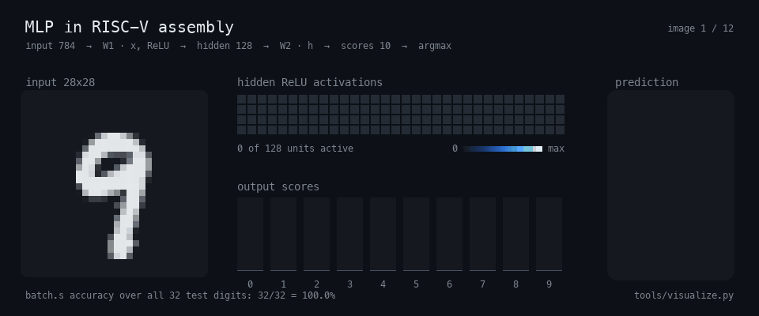

# MLP in RISC-V Assembly



A small neural network that classifies handwritten digits (MNIST), with the whole forward pass written in RISC-V assembly: file I/O, matrix products, ReLU and argmax. The programs run in the Venus RISC-V simulator. The network is trained in NumPy with `tools/train.py` and exported as integer matrices that the assembly reads directly.

The GIF above comes from a real run of `src/batch.s` in Venus. For each image it shows the input, the 128 hidden activations after ReLU, the 10 output scores and the predicted digit.

## The network

```
H = relu(W1 · X)        W1: 128 x 784
S = W2 · H              W2: 10 x 128
prediction = argmax(S)
```

- `X` holds one image per column: 784 raw pixel values from 0 to 255.
- There are no biases and no floating point. Every product and sum is a 32-bit integer operation.
- `W1` holds integers in [-127, 90] and `W2` holds integers in [-31, 24].

### Accuracy

| | Accuracy |
| --- | --- |
| Float model after training (MNIST test set, 10,000 images) | 97.93% |
| Integer model, as the assembly computes it (same 10,000 images) | 97.91% |
| `src/batch.s` in Venus on the 32 exported test digits | 32/32 = 100.0% |

The integer figure comes from a NumPy reference of the integer network. `tools/check.py` confirms that the assembly produces exactly the same hidden activations and scores, bit for bit, on every exported digit. Running all 10,000 test images through the simulator would take hours, so only the 32-digit batch runs in Venus.

### Training and quantization

`tools/train.py` trains the float network on the 60,000 MNIST training images: softmax cross-entropy, Adam, mini-batches of 128, 12 epochs with a cosine learning-rate decay, pixels scaled to [0, 1]. A fixed seed makes the run reproducible.

After training, each weight matrix is scaled and rounded to integers. ReLU commutes with a positive scale factor, so the integer network ranks the classes almost exactly as the float network does. Feeding raw 0..255 pixels into the integer network changes only the overall scale of the scores.

The script then checks for overflow analytically. Pixels are non-negative, so hidden unit `j` is at most `255 · Σ max(W1[j,i], 0)`. That bound gives a worst case for every output score. `W1` uses 8 bits, and `W2` takes the most bits (up to 8) for which no input image can push a score past the int32 range. With the current weights this is 6 bits, and the worst case is 1,321,465,590, below 2^31 - 1.

## Layout

| Path | Contents |
| --- | --- |
| `src/classify.s` | Classifies one image: writes the 10 scores and prints the predicted digit. |
| `src/batch.s` | Classifies a batch in one pass and prints the predictions, labels and accuracy. |
| `src/mlp.s` | `mlp_forward`: the two layers, shared by both programs. |
| `src/matmul.s`, `src/dot.s` | Integer matrix product built on a strided dot product. |
| `src/relu.s` | In-place ReLU. |
| `src/argmax.s` | `argmax` over a vector and `argmax_cols` over the columns of a matrix. |
| `src/matio.s` | `load_matrix` and `save_matrix` for the binary matrix format. |
| `src/sys.s` | Wrappers for the simulator's environment calls, the heap allocator and `print_matrix`. |
| `tests/` | One program per function. Each lists its expected output in `#>` comment lines. |
| `data/model/` | `w1.bin`, `w2.bin`: the trained integer weights. |
| `data/digits/` | 32 MNIST test images as `digits.bin` (784 x 32) and `labels.bin` (1 x 32), plus each image on its own as `00.bin` ... `31.bin`. `labels.txt` lists the labels. |
| `tools/train.py` | Trains, quantizes and exports the model and the test digits. |
| `tools/matrix.py` | Converts between binary and text matrices, and converts a PNG into an input column. |
| `tools/check.py` | Runs all tests and both programs in Venus and compares the results with NumPy. |
| `tools/visualize.py` | Renders `assets/demo.gif` from a Venus run of `batch.s`. |

### Matrix format

A matrix file holds two little-endian int32 values (rows, columns), followed by the elements as little-endian int32 in row-major order. In memory, the assembly describes a matrix with a 12-byte record: rows, columns, and the address of the first element. The record starts with the same two words as the file header, so `load_matrix` reads the header straight into the record.

## Running

You need Java and a jar of the [Venus RISC-V simulator](https://github.com/ThaumicMekanism/venus). Keep the jar outside the repository, and run all commands from the repository root. The flag `-ms -1` lifts the simulator's default step limit, which a full forward pass exceeds.

### Classify one image

```sh
java -jar /path/to/venus.jar -ms -1 src/classify.s \
    data/model/w1.bin data/model/w2.bin data/digits/00.bin scores.bin
```

This prints `9`, the label of `00.bin`, and writes the scores to `scores.bin`. To read them:

```sh
python3 tools/matrix.py to-txt scores.bin
```

### Classify a batch

```
src/batch.s W1 W2 DIGITS LABELS SCORES [HIDDEN]
```

```sh
java -jar /path/to/venus.jar -ms -1 src/batch.s \
    data/model/w1.bin data/model/w2.bin \
    data/digits/digits.bin data/digits/labels.bin scores.bin
```

```
predictions: 9 8 6 0 8 1 2 3 7 0 1 3 8 1 9 1 3 7 6 7 2 5 0 4 4 5 0 2 6 9 5 4
labels:      9 8 6 0 8 1 2 3 7 0 1 3 8 1 9 1 3 7 6 7 2 5 0 4 4 5 0 2 6 9 5 4
accuracy:    32/32 = 100.0%
```

The images are the columns of one matrix, so the two matrix products process the whole batch at once. If `HIDDEN` is given, the 128 x N activations after ReLU are written there too. The accuracy is truncated to one decimal.

Exit codes for both programs:

| Code | Meaning |
| --- | --- |
| 1 | A file could not be opened, read, written or closed. |
| 2 | Matrix shapes do not fit together. |
| 3 | Wrong number of arguments. |
| 4 | The label count does not match the number of images (`batch.s` only). |

### Your own digit

```sh
python3 tools/matrix.py png my_digit.png my_digit.bin
python3 tools/matrix.py show my_digit.bin
java -jar /path/to/venus.jar -ms -1 src/classify.s \
    data/model/w1.bin data/model/w2.bin my_digit.bin scores.bin
```

The `png` command converts the image to grayscale and inverts it if the background is light. It then crops the image to the ink, scales it into a 20x20 box and centres it on a 28x28 canvas, the same framing as MNIST. `show` prints the result as text art.

## Tests and verification

```sh
pip install numpy pillow
python3 tools/check.py --venus /path/to/venus.jar
```

`check.py` does three things:

- It runs every program in `tests/` and compares the output with the `#>` lines. `test_matmul_shape.s` must exit with code 2.
- It runs `batch.s` on the 32 digits and requires the hidden activations, scores and predictions to equal the NumPy reference bit for bit.
- It runs `classify.s` on each digit separately. Use `--no-singles` to skip this step, which takes a few minutes.

A single test can also be run directly:

```sh
java -jar /path/to/venus.jar tests/test_dot.s
```

The programs also pass the simulator's calling-convention checker (`-cc`).

## Retraining

MNIST is not stored in the repository. `train.py` reads the four original `.gz` files from a folder of your choice, and `--download` fetches them from a public mirror first:

```sh
python3 tools/train.py --mnist ~/datasets/mnist --download
```

This overwrites `data/model/` and `data/digits/` and prints the float and integer test accuracy. Options include `--epochs`, `--lr`, `--bits1`, `--bits2`, `--digits` (how many test images to export) and `--seed`.

## Regenerating the GIF

```sh
python3 tools/visualize.py --venus /path/to/venus.jar
```

The script runs `batch.s` in Venus with the hidden output enabled, then draws the first 12 digits (`--count`) from the matrices that Venus wrote. The output goes to `assets/demo.gif`. `--java` or the `JAVA` environment variable selects the Java executable.
